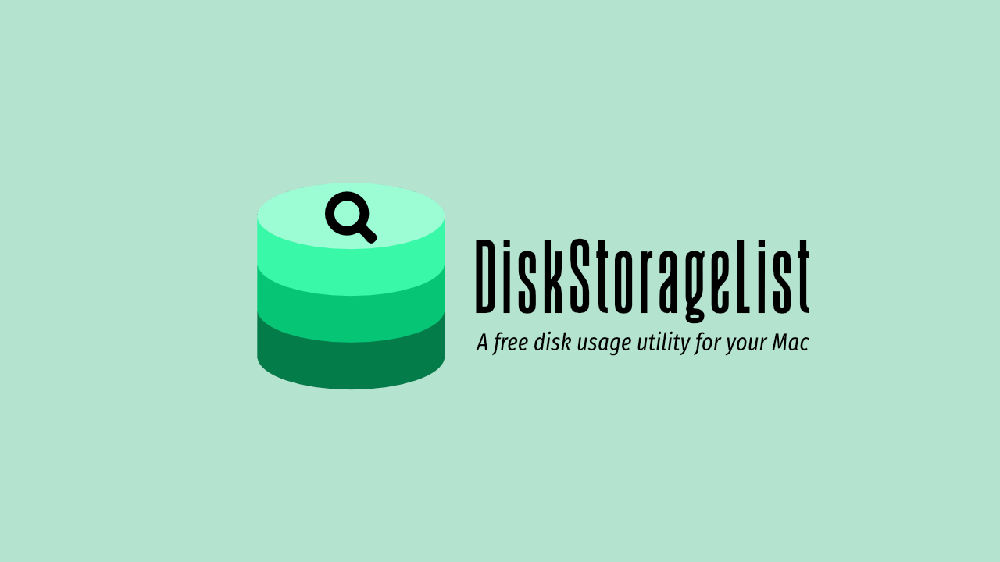

# DiskStorageList

DiskStorageList is a free macOS app for finding what takes up space on a disk or in a folder. The interface is available in English and Swedish.

- Browse results in a column view or an expandable list. Sort and filter by name and size.
- Compare local disk usage with logical file size, including for items in cloud folders.
- Rescan a selected folder, preview files with Quick Look, show items in Finder, share them, or move them to the Trash after confirmation.
- Adjust row spacing in **Settings → Appearance**. The compact sidebar shows one line per place. Regular adds a disk usage or scan progress bar when available, and Spacious shows more details.

## Requirements

- macOS 15 (Sequoia) or later. Universal builds support Apple Silicon and Intel.
- Full Disk Access is optional. You can grant it in **System Settings → Privacy & Security → Full Disk Access** to include folders that macOS would otherwise protect. The app reports folders it could not read, and scan totals exclude their contents.

## Privacy

Scans run locally and read file system metadata without opening file contents or downloading cloud files. DiskStorageList does not collect analytics or send scan results. The Share button uses the macOS share sheet for items you choose to share.

## Legal

© CutUp Studios AB. All rights reserved.

DiskStorageList is freeware. The license and terms of use are in `LICENSE.rtf` on the downloaded disk image (DMG).

Apple, macOS and Finder are trademarks of Apple Inc. All other trademarks belong to their respective owners. DiskStorageList is not affiliated with or endorsed by any of them.
